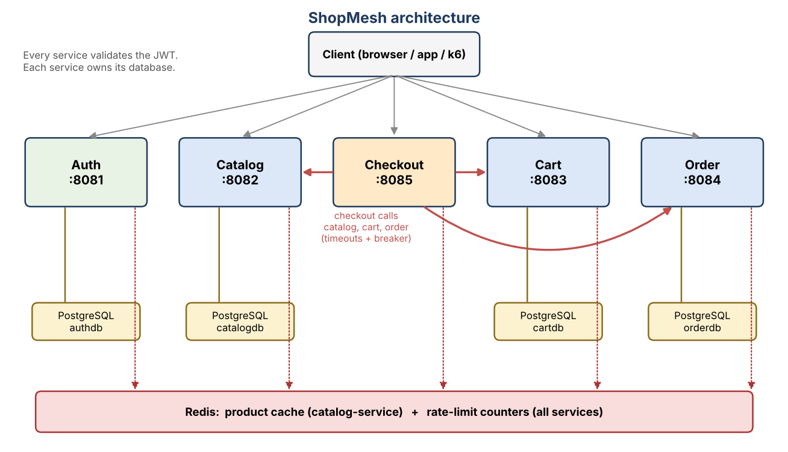
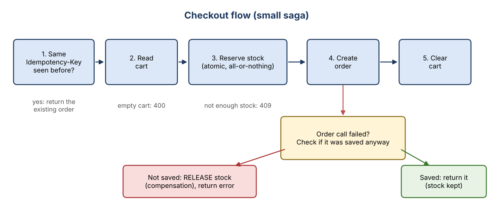

# ShopMesh: E-Commerce Backend Microservices

A small e-commerce backend split into independent services: **auth, catalog, cart, checkout and order**.
Built with **Java 17, Spring Boot 3, PostgreSQL, Redis and JWT**, with rate limiting, Redis caching, and
fault-tolerance patterns (timeouts, circuit breakers, compensation) in the checkout flow.

> **Status:** the code, unit tests, Docker setup and load-test script are all included. Load-test results are **not**
> included yet: run the steps in [Load testing](#load-testing) and fill in the table with your own numbers.



## Why split the checkout?
In a single application, browsing, carts, stock and orders all fail and scale together. Here each part is its own
service with its own database, so a slow or broken service can be contained instead of taking everything down.

| Service | Port | Database | What it does |
|---|---|---|---|
| auth-service | 8081 | authdb | Register, login, issues JWTs (BCrypt password hashes) |
| catalog-service | 8082 | catalogdb | Products, stock, **Redis-cached reads**, atomic stock reservation |
| cart-service | 8083 | cartdb | One cart per user |
| order-service | 8084 | orderdb | Stores orders, idempotent creation |
| checkout-service | 8085 | none (stateless) | Orchestrates cart -> stock -> order, with compensation |

## Main features
- **JWT authentication** on every service (HS256, expiry, roles `USER` / `ADMIN`).
- **Rate limiting** per user (or IP when not logged in), using Redis counters; returns `429` + `Retry-After`.
  If Redis is down it fails open, so the API stays available.
- **Redis caching** for product reads (`@Cacheable`), evicted on updates and after stock changes.
  Can be switched off with `CACHE_TYPE=none` to measure the difference.
- **Checkout saga**: reserve stock, create order, and release stock if order creation fails.
  Uses an `Idempotency-Key` so a retry never takes stock twice.
- **Fault tolerance**: connect/read timeouts, Resilience4j circuit breakers per downstream service, retries only on safe reads,
  clean `503` when a dependency is down.
- **No overselling**: stock is decremented with one atomic SQL update (`... where stock >= qty`).
- **Internal-only endpoints** (`/internal/**`) need a shared key, so users can't create orders with their own prices.



## Run it
Requirements: Docker, Docker Compose (and Java 17 + Maven if you want to build locally).
```bash
docker compose up --build        # starts Postgres, Redis and the 5 services (200 demo products are seeded)
./scripts/demo.sh                # register -> login -> cart -> checkout -> replay -> orders
```
Run only the tests: `mvn verify`

## API summary
| Method | Path | Notes |
|---|---|---|
| POST | `/api/auth/register`, `/api/auth/login` | public; login returns `{token, tokenType, expiresInSeconds}` |
| GET | `/api/products?page=&size=` , `/api/products/{id}` | cached |
| POST / PUT | `/api/products`, `/api/products/{id}` | `ADMIN` only (default admin: `admin@shop.local` / `admin12345`, change it) |
| GET / POST / DELETE | `/api/cart`, `/api/cart/items`, `/api/cart/items/{productId}` | current user's cart |
| POST | `/api/checkout` | header `Idempotency-Key` required |
| GET | `/api/orders`, `/api/orders/{id}` | current user's orders |

Send the token as `Authorization: Bearer <token>`.

## Load testing
The target is the cached read path (`GET /api/products/{id}`) at 1,000 requests per second, with and without the cache.
Install [k6](https://k6.io), then:
```bash
# A) no cache (rate limit raised, otherwise one user would be limited to 120 req/min)
RATE_LIMIT_RPM=100000000 CACHE_TYPE=none  docker compose up -d --force-recreate catalog-service
RPS=1000 DURATION=60s k6 run loadtest/catalog-read.js

# B) with Redis cache
RATE_LIMIT_RPM=100000000 CACHE_TYPE=redis docker compose up -d --force-recreate catalog-service
RPS=1000 DURATION=60s k6 run loadtest/catalog-read.js
```
Use the same machine, run each case more than once, and discard the first (warm-up) run. Record your results here:

| Case | RPS achieved | p50 | p95 | p99 | Error rate |
|---|---|---|---|---|---|
| No cache | _fill in_ | | | | |
| Redis cache | _fill in_ | | | | |
| **Improvement** | | _fill in_ | _fill in_ | _fill in_ | |

Only claim a percentage you actually measured, and say on which machine.

## Tests
- `common`: JWT (round trip, wrong secret, expired, short secret), rate limiter (limit, fail-open), internal-key filter.
- `checkout-service`: happy path, stock released when order fails, order saved but response lost, idempotent replay, empty cart.
- GitHub Actions runs `mvn verify` on every push (`.github/workflows/ci.yml`).

## Design decisions and trade-offs
- **Database per service**: no cross-service joins; services talk over HTTP. Data duplicated on purpose (e.g. the order stores product name and price at purchase time).
- **Shared JWT secret** (HS256) keeps the demo simple. In production, use an identity provider with asymmetric keys (RS256 + JWKS) so services only hold a public key.
- **Cache staleness**: product pages can show slightly old stock (30 s TTL for lists; single products are evicted after stock changes). Checkout always checks the real stock in the database.
- **Rate limiter** uses a fixed one-minute window (simple, allows a burst at window edges). A sliding window or token bucket (Lua script) is more precise.
- **Saga without an outbox**: if the release-stock call itself fails, the failure is logged for reconciliation, not retried automatically.
- Schema is created by Hibernate `ddl-auto=update` for convenience. Use Flyway/Liquibase for real deployments.

## Known limitations / roadmap
- Payments are not implemented (orders are created as `CREATED`).
- No API gateway; clients call services directly (a Spring Cloud Gateway in front would be the next step).
- Add an outbox + retry job for stock-release compensation, metrics/tracing (Micrometer, OpenTelemetry), and integration tests with Testcontainers.

## Project layout
```
common/            JWT filter, rate limiter, internal-key filter, error handling
auth-service/      users and tokens
catalog-service/   products, Redis cache, stock reservation
cart-service/      carts
order-service/     orders (idempotent)
checkout-service/  orchestration, circuit breakers, compensation
loadtest/          k6 script
docker/, Dockerfile, docker-compose.yml, scripts/demo.sh, docs/
```
